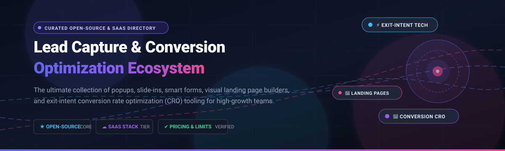

# 🎯 Awesome Lead Capture & Conversion Optimization

  

  <strong>Curated ecosystem of SaaS platforms, open-source libraries, and self-hosted tools for Lead Capture &amp; Conversion Rate Optimization (CRO).</strong>

  
  
  
  
  
  
  

---

## 📑 Table of Contents
- [🔍 Sector Overview &amp; Market Dynamics](#-sector-overview--market-dynamics)
- [☁️ SaaS &amp; Commercial Platforms](#️-saas--commercial-platforms)
- [💻 Open-Source Repositories &amp; Self-Hosted Tooling](#-open-source-repositories--self-hosted-tooling)
  - [⭐ Ranked Open-Source GitHub Projects](#-ranked-open-source-github-projects)
  - [🧩 WordPress Plugins &amp; Ecosystem Tools](#-wordpress-plugins--ecosystem-tools)
- [🤝 How to Contribute](#-how-to-contribute)
- [💖 Support &amp; Sponsorship](#-support--sponsorship)
- [📈 Star History](#-star-history)
- [⚖️ Disclaimer](#️-disclaimer)

---

## 🔍 Sector Overview & Market Dynamics

> The global **Lead Capture and Conversion Rate Optimization (CRO) software market** is valued at approximately **$3.0 Billion to $4.5 Billion** combined (with Lead Capture software accounting for ~$1.8B–$2.8B and CRO software representing ~$1.2B–$1.7B), expanding rapidly at an estimated **11.4% to 11.6% CAGR**.  
> The sector is **structurally hybrid**: it is **highly fragmented across the SMB long-tail** with thousands of standalone popup widgets, modal scripts, and WordPress form plugins competing on price and ease of use, but **moderately concentrated at the enterprise level**, where market power and revenue consolidate around multi-product CRM and digital experience suites (such as HubSpot, Salesforce, and Optimizely) that integrate lead capture directly into unified customer data platforms (CDPs) and marketing automation engines.

---

## ☁️ SaaS & Commercial Platforms

The following table compares leading commercial lead capture and conversion optimization platforms, sorted by **company size / valuation / annual revenue** (descending).

| Platform | Company Size (Valuation / Revenue) | Starting Tier Pricing | Free Tier / Free Trial Limits | Key Specialization & Capabilities |
| :--- | :--- | :--- | :--- | :--- |
| **[HubSpot Lead Capture Software](https://www.hubspot.com/)** | **~$12.0B Market Cap** (~$3.13B ARR) | **$15/seat/mo** (billed annually) or $20/seat/mo on Starter tier | **Free forever plan**: Up to 1,000 total CRM contacts, 2,000 marketing email sends/month, 2 user seats, standard forms, popups, and landing pages with HubSpot branding | Enterprise-grade inbound marketing & CRM ecosystem; native forms, popups, and progressive profiling connecting directly to CRM contact pipelines. |
| **[Privy](https://privy.com/)** | **~$700M Acquired / Parent Scale** (~$30M ARR, acquired by Attentive) | **$24/month** (Pop-ups & Displays tier) | **15-day free trial**: Full access to all displays, pop-ups, spin-to-win wheels, and targeting triggers (no credit card required) | E-commerce conversion suite specialized for Shopify; high-converting spin-to-win popups, flyouts, and SMS/email capture integrations. |
| **[Unbounce](https://unbounce.com/)** | **~$52M Valuation** (~$35M ARR, acquired by Crest Rock Partners) | **$99/month** (Build tier, billed annually) | **14-day free trial**: Access to drag-and-drop landing page builder, smart traffic AI routing, popups, and sticky bars (credit card required) | High-performance landing page builder equipped with Smart Traffic AI conversion routing, visual A/B testing, and sticky capture bars. |
| **[Leadpages](https://www.leadpages.com/)** | **~$38M Funding / ~$18M ARR** (acquired by Redbrick) | **$37/month** (Standard tier, billed annually) | **14-day free trial**: Full access to drag-and-drop builder, 1 custom domain, mobile-responsive templates, pop-ups, and alert bars | Conversion-oriented landing page and website builder tailored for small businesses and solo founders; includes alert bars and opt-in pop-ups. |
| **[OptinMonster](https://optinmonster.com/)** | **~$45M+ Parent ARR** (Awesome Motive portfolio, ~$3M ARR) | **$9/month** (Basic tier, billed annually at $108/yr) or $21/mo | **14-day unconditional money-back guarantee**: 2,500 impressions/month across 1 site on Basic tier (no permanent free tier) | The industry benchmark for popup and opt-in conversion; patented Exit-Intent® tracking technology, floating bars, fullscreen welcome mats, and multi-step funnels. |
| **[Sumo (SumoMe)](https://sumo.com/)** | **Bootstrapped** (~$5M ARR, part of AppSumo network) | **$39/month** (Pro tier billed annually) or $49/mo | **Free forever plan**: Basic email opt-in forms, visitor analytics, and visitor pop-ups capped at 10,000 emails/month and up to 200 subscribers | Proven growth-hacking suite providing exit-intent popups, floating header bars, scroll boxes, and instant subscriber capture integrations. |
| **[Sleeknote](https://sleeknote.com/)** | **~$3M ARR** (acquired by Drip) | **€49/month** (~$53/mo, Lite tier billed annually) | **14-day free trial**: Full access to 100+ popup templates, drag-and-drop builder, and cart abandonment triggers (no credit card required) | E-commerce lead capture platform engineered for non-intrusive slide-ins, bottom bars, gamified popups, and basket recovery. |
| **[ConvertFlow](https://www.convertflow.com/)** | **Bootstrapped / Private** (~$2M ARR) | **$99/month** (Prime tier) | **Free forever plan**: Up to 250 monthly visitors, 1 website, with visual builder for forms, quizzes, sticky bars, and modal popups | Visual funnel-builder enabling marketers to deploy conditional multi-step quizzes, popup surveys, personalized embedded forms, and landing pages. |
| **[Wisepops](https://wisepops.com/)** | **Bootstrapped / Private** (~$2M ARR) | **$49/month** (Essential tier for 10,000 pageviews/mo) | **14-day free trial**: Access to smart popups, notification feeds, exit-intent overlays, and contextual behavioral targeting (no credit card required) | Onsite marketing and conversion suite combining exit-intent popups, contextual slide-ins, dynamic website notifications, and deep audience segmentation. |

---

## 💻 Open-Source Repositories & Self-Hosted Tooling

Lead capture and conversion optimization in open-source spans full-stack self-hosted marketing platforms, visual page and form builders, user analytics, and lightweight exit-intent client libraries.

### ⭐ Ranked Open-Source GitHub Projects

The following repositories are sorted by **GitHub Stars_Count** (descending). The badge links directly to each project's GitHub stargazers page.

| Repository | GitHub_Stars | Description & Conversion Capabilities |
| :--- | :---: | :--- |
| **[PostHog / posthog](https://github.com/PostHog/posthog)** |  | All-in-one open-source product analytics, conversion funnel tracking, session recording, feature flags, and A/B multivariate testing platform. |
| **[GrapesJS / grapesjs](https://github.com/GrapesJS/grapesjs)** |  | Extensible, open-source visual multi-purpose HTML/CSS web builder framework. Ideal for embedding customizable landing page and popup editors directly into web applications. |
| **[Formbricks / formbricks](https://github.com/formbricks/formbricks)** |  | Open-source experience management & in-app micro-survey suite. Enables targeted user feedback popups, event-triggered lead qualification forms, and conversion attribution. |
| **[Mautic / mautic](https://github.com/mautic/mautic)** |  | The standard open-source marketing automation platform (GPLv3). Provides built-in lead generation forms, landing page creators, dynamic web content, lead scoring, and automated nurture campaigns. |
| **[HeyForm / heyform](https://github.com/heyform/heyform)** |  | Modern open-source conversational form builder. Features interactive conversational UX, conditional branching, customizable logic, and self-hosted lead capture. |
| **[GrowthBook / growthbook](https://github.com/GrowthBook/growthbook)** |  | Open-source experimentation and feature flagging platform. Provides visual A/B testing, statistical conversion analysis, and targeting rule engines for optimizing funnel conversions. |
| **[ohmyform / ohmyform](https://github.com/ohmyform/ohmyform)** |  | Free and open-source alternative to Typeform and Google Forms for self-hosted lead intake, customer feedback, and multi-step surveys. |
| **[carlsednaoui / ouibounce](https://github.com/carlsednaoui/ouibounce)** |  | Classic, lightweight library for displaying exit-intent modal popups before a visitor leaves the web page. Supports sensitivity thresholds, cookie expiration, and custom callbacks. |
| **[daltonmenezes / use-exit-intent](https://github.com/daltonmenezes/use-exit-intent)** |  | Modern React / TypeScript hook designed to trigger exit-intent conversion modals, opt-in promotions, and alerts with desktop cursor and mobile blur handlers. |
| **[aialvi / openfunnels](https://github.com/aialvi/openfunnels)** |  | Open-source funnel builder and CRM-lite web application designed for fast lead-capture funnels with drag-and-drop landing page templates, lead alerts, and domain mapping. |
| **[vidual-labs / openflow](https://github.com/vidual-labs/openflow)** |  | Self-hosted lead generation form platform alternative to Typeform; features iframe postMessage embedding, per-form subdomains, and lead sync into Lodgely. |
| **[chaitin / AntLeads](https://github.com/chaitin/AntLeads)** |  | AI-driven lead management and automation system featuring an embeddable, zero-dependency JavaScript lead capture widget with real-time UTM parameter tracking. |

---

### 🧩 WordPress Plugins & Ecosystem Tools

For teams running on WordPress, several battle-tested plugins offer self-hosted popup and opt-in management:

- **[OptinFlare](https://wordpress.org/plugins/optinflare/)**  
  Free WordPress **popup and opt-in form plugin** with 20,000+ active installations. Features popups, fly-ins, inline forms, and sticky bars triggered by exit-intent, scroll depth, and inactivity. Includes GDPR consent profiles and local database subscriber storage with CSV export.
  
- **[Brave Popup Builder](https://wordpress.org/plugins/brave-popup-builder/)**  
  Visual drag-and-drop **popup builder** for WordPress (4.8/5 rating across 200+ reviews). Provides customizable display frequencies, mobile-responsive layouts, conversion tracking, and direct WooCommerce cart integrations.

---

## 🤝 How to Contribute

Contributions are warmly welcomed! Help expand this directory by adding new tools, updating pricing details, or submitting improvements:

1. **Fork the repository** to your personal GitHub account.
2. **Create a descriptive feature branch** (`git checkout -b feat/add-conversion-tool`).
3. **Add or update entries in `README.md`** following the established table structure, Stars_Badge syntax, and factual criteria.
4. **Commit your modifications** with clear commit messages (`git commit -m "feat: add Formbricks to open-source table"`).
5. **Push to your branch** and open a **Pull Request** detailing why the tool is relevant to Lead Capture & Conversion Optimization.

⭐ **Don't forget to star this repository** if you find it helpful!

---

## 💖 Support & Sponsorship

Thank you for exploring this curated repository! Maintaining and updating high-quality developer and marketing ecosystems requires continuous community care.

If you find this project valuable for your business, agency, or open-source journey, please consider supporting us:
- ⭐ **Star this repository** to improve its visibility across GitHub.
- 🍴 **Fork the repo** to keep a local reference or build custom tool evaluations.
- 📢 **Share it** with friends, colleagues, and marketing tech enthusiasts on Twitter, LinkedIn, and developer forums.
- ☕ **Buy us a coffee / become a sponsor**: Support ongoing research and maintenance directly via the [GitHub Sponsors Dashboard](https://github.com/sponsors/ishandutta2007).

Every bit of encouragement and sponsorship keeps this ecosystem thriving!

---

## 📈 Star History

---

## ⚖️ Disclaimer

- This curated list is **community-maintained** for educational, architectural, and evaluation purposes; inclusion does not imply commercial endorsement.
- Ensure all lead-capture mechanisms, trackers, and popup scripts comply with data privacy standards (**GDPR, CCPA, ePrivacy Directive**) by implementing verifiable opt-in consent mechanisms.
- All pricing metrics, tier limits, and valuations were verified as of **November 2026** and remain subject to change by their respective vendors.
